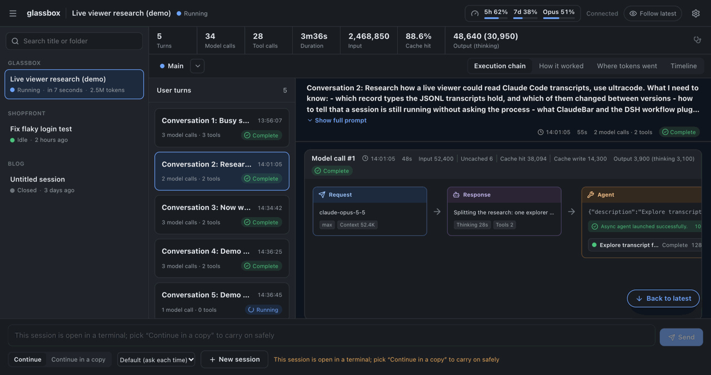
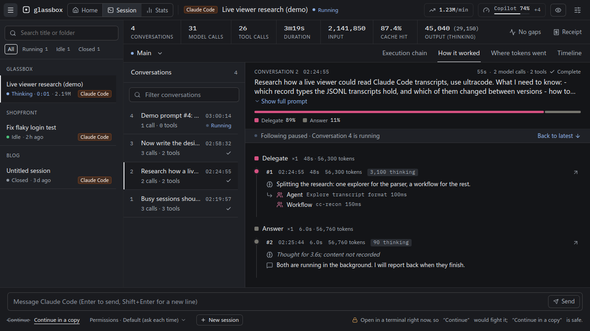
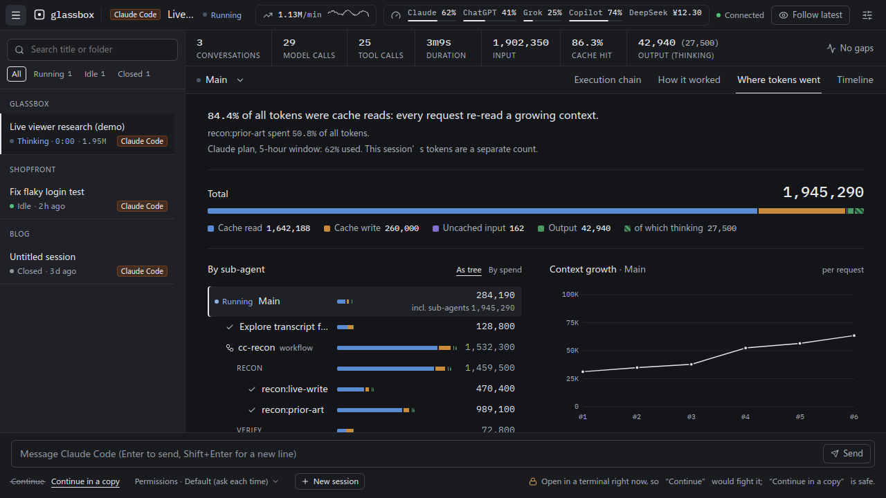
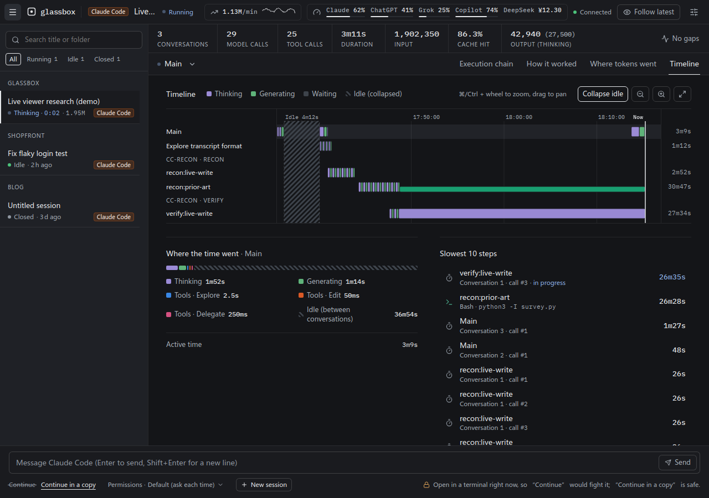
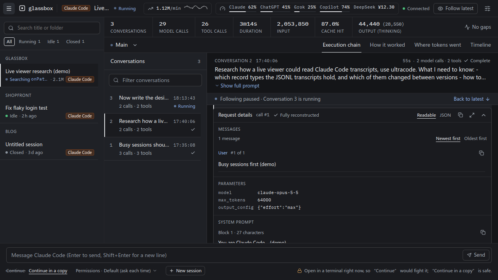
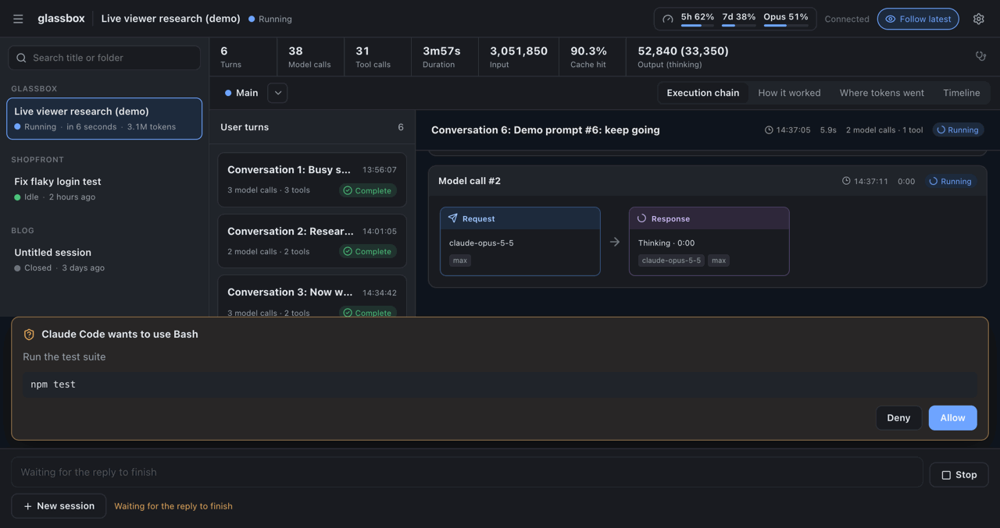
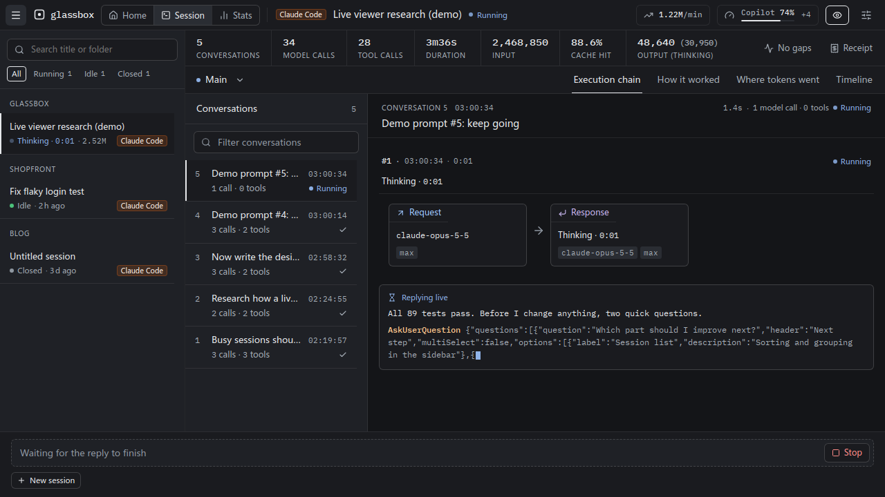

[中文](README.zh-CN.md)

# glassbox

**Turn Claude Code into a glass box.** While it works, see exactly what it is doing, which tools it calls, and where the tokens and the time go, including max effort and ultracode (Workflow multi-agent) runs. You can also message it straight from glassbox.

> A local, live viewer for Claude Code sessions: the execution chain, a step-by-step breakdown of how the agent worked, where the tokens and the time went, plan quota, and multi-agent workflow runs.



**Execution chain**: every model call of a turn, laid out as request → response → tools. Agent / Workflow cards show the progress of their sub-agents and phases; click through to see that agent's own chain.

|                                                          How it worked                                                           |                                                  Where tokens went                                                  |
| :------------------------------------------------------------------------------------------------------------------------------: | :-----------------------------------------------------------------------------------------------------------------: |
|                                                                                           |                                                                         |
|            What each step thought, said and did, grouped into phases such as explore / edit / run; failures stand out            | A one-line takeaway, the mix of cache reads, cache writes and output, a per-agent tree and the context growth curve |
|                                                           **Timeline**                                                           |                                                 **Request details**                                                 |
|                                                                                             |                                                                           |
| Whether the time went to thinking, generating, tools or idling; one lane per agent, so parallel workflow agents are easy to read |      The system prompt, messages and tools each request actually sent, as JSON trees you can copy and enlarge       |
|                                                       **Sending messages**                                                       |                                                  **Live overlay**                                                   |
|                                                                                      |                                                                                |
|      Continue a session, or continue in a copy, from glassbox; replies stream in and permission prompts pop up in the page       |          No more black box while the model thinks: live thinking time, thinking tokens and streamed output          |

## Run it

Requires Node.js ≥ 22.19 and Claude Code already in use on this machine.

```sh
npx --yes github:gogy717/glassbox
```

The first run downloads and builds (about a minute), then opens `http://127.0.0.1:7788` in your browser.

Pin a version (recommended, so the contents do not change with the branch):

```sh
npx --yes github:gogy717/glassbox#v0.2.0
```

Common options:

| Option                                    | Description                                                                                                                                                  |
| ----------------------------------------- | ------------------------------------------------------------------------------------------------------------------------------------------------------------ |
| `--port <n>`                              | Port, default `7788`                                                                                                                                         |
| `--no-open`                               | Don't open a browser                                                                                                                                         |
| `--claude-dir <path>`                     | Claude Code data dir, default `$CLAUDE_CONFIG_DIR` or `~/.claude`                                                                                            |
| `--grok-dir <path>` / `--no-grok`         | Grok data dir, default `$GROK_HOME` or `~/.grok` (Grok sessions show whenever it exists) / don't show them                                                   |
| `--codex-dir <path>` / `--no-codex`       | Codex data dir, default `$CODEX_HOME` or `~/.codex` (Codex sessions show whenever it exists) / don't show them                                               |
| `--omp-dir <path>` / `--no-omp`           | oh-my-pi dir, default `~/.omp` (sessions show whenever `agent/sessions` exists) / show neither its sessions nor its usage cache                              |
| `--opencode-dir <path>` / `--no-opencode` | OpenCode data dir, default `$XDG_DATA_HOME/opencode` or `~/.local/share/opencode` (OpenCode sessions show whenever it holds `opencode.db`) / don't show them |
| `--claude-bin <path>`                     | The `claude` used to send messages, default the one on `PATH`                                                                                                |
| `--use-api-key`                           | Let the `claude` started for messages use `ANTHROPIC_API_KEY` (default: the account you signed in with in the terminal)                                      |
| `--fetch-quota[=<list>]`                  | Ask providers for plan usage every 5 minutes: `anthropic`, `xai`, `deepseek`; alone, all three (see Data and privacy)                                        |
| `--demo`                                  | Run on built-in demo data: no local sessions are read and `claude` is never started                                                                          |
| `--help`                                  | List every option                                                                                                                                            |

To install it for good: `npm install -g github:gogy717/glassbox`, then run `glassbox`; uninstall with `npm uninstall -g glassbox`. To upgrade, run the command again with the new tag.

## What you can see

- **Execution chain**: organised by user turn, one row per model call: request → response → tools, failures in red. While the model thinks it shows "Thinking · m:ss", and running tools count up live.
- **How it worked**: each turn told step by step as "thought → said → did → outcome", grouped into phases such as explore / edit / run / delegate.
- **Where tokens went**: cache reads, cache writes, uncached input and output (including thinking); totals per agent and per Workflow phase; the context growth curve (with compaction points); the most expensive requests.
- **Timeline**: one lane per agent, split into waiting / thinking / generating / tools; where the time went and the 10 slowest steps.
- **Multi-agent**: phases, agents, status and tokens of Agent sub-agents and Workflow (ultracode) runs; drill into any agent to see its own chain.
- **Request details**: with Claude Code ≥ 2.1.300, the system prompt, tools and messages each request actually sent to the model.
- **Plan usage per provider**: one meter per provider in the top bar, its window closest to the limit; click for every window, reset times, the plan, and where the numbers came from. Stale data greys out per provider and says how old it is.
  - Anthropic: 5-hour / weekly / per-model quota from Claude Code's own cache (as ClaudeBar reads it).
  - OpenAI: the ChatGPT plan's limits from Codex's session logs, or from oh-my-pi's cache.
  - xAI (SuperGrok) and GitHub Copilot: from oh-my-pi's usage cache.
  - DeepSeek: the account balance, with `--fetch-quota`.
- **Grok, Codex, oh-my-pi and OpenCode sessions**: when Grok Build, the Codex CLI, oh-my-pi or OpenCode is installed, their sessions appear in the sidebar too (view only), with sub-agents, tokens and time broken down the same way. An OpenCode session's child sessions show as its sub-agents.
- **Diagnostics**: the small icon at the right of the summary bar lists what data this session lacks, and why.

## Sending messages from glassbox

The box at the bottom sends messages straight to Claude Code. Replies, thinking tokens and tool calls appear live, and permission prompts and Claude's questions pop up in the page for you to answer.
- **New session**: pick a working directory and a first message.
- **Continue**: carry on a session that has been closed.
- **Continue in a copy**: use this while the session is still open in a terminal. It continues in a new copy of the session, so it never fights the terminal over the same transcript.

glassbox starts the `claude` installed on your machine, with your own sign-in, so your `CLAUDE.md`, hooks and settings apply as usual. It only starts when you press Send, and the process ends when you close the session or quit glassbox.

## Accounts and terms

glassbox has no sign-in of its own and never reads or stores credentials (unless you add `--fetch-quota`, below). To send a message it starts the official `claude` installed on your machine (in its headless stream-json mode), with the account you are signed in to: the same one you use in a terminal. Make sure this use fits the Anthropic terms that apply to your account; if you are unsure, start glassbox with `--use-api-key` to use an API key instead.

glassbox is an independent project, not affiliated with or endorsed by Anthropic.

## Data and privacy

- Reads only:
  - `~/.claude` (session transcripts) and the `cachedUsageUtilization` entry of `~/.claude.json`;
  - `~/.grok`;
  - the session records in `~/.codex` (`sessions/`, `archived_sessions/`, `session_index.jsonl`; never credential files such as `auth.json`);
  - oh-my-pi's sessions in `~/.omp/agent/sessions` with the full tool output omp saves beside them (`$PI_CODING_AGENT_DIR` moves `~/.omp/agent`), and its usage cache in `~/.omp/agent/agent.db`: only the usage reports in its `cache` table, never the credential tables. On Linux, `/proc/net/unix` tells whether oh-my-pi has a session open;
  - OpenCode's database `~/.local/share/opencode/opencode.db`: its sessions, messages and parts. The names of running processes (`/proc` on Linux, `ps` on macOS) tell whether OpenCode runs.
- Never changes a Claude Code, Grok, Codex, oh-my-pi or OpenCode file (when you message from glassbox, `claude` writes its own records, just as in a terminal), with one caveat for the SQLite databases below.
- oh-my-pi and OpenCode keep data in SQLite, which glassbox opens read-only for one short query at a time. While the owning app has pages waiting in its write-ahead log (`-wal`), and only when the `-wal` and `-shm` files have the database's own permissions, glassbox reads them as they are (`mode=ro`, `readonly_shm=1`: nothing is written, not even the shared-memory index); otherwise it opens the database file alone as immutable, and changes not yet checkpointed show up a little later. One rare race remains: if the app deletes its `-wal` between glassbox's check and its open, SQLite creates an empty `-wal` again (with the database's permissions, as the app itself would) and that one read fails. SQLite offers no way to rule this out.
- Accepts connections from this machine only: it checks where a connection really comes from, and validates `Host` / `Origin` too. Every write needs a token generated at each start, so other web pages cannot read your sessions or send messages through it.
- Does not pass `ANTHROPIC_API_KEY` to the `claude` it starts (so you are not billed by the API by accident) unless you add `--use-api-key`.
- glassbox itself makes no outbound network requests and has no telemetry, unless you add `--fetch-quota`. Then, every 5 minutes, for each provider you selected, it reads one credential and sends it to that provider's own host, and nowhere else:

  | Provider    | Request                                             | Credential                                                                                      |
  | ----------- | --------------------------------------------------- | ----------------------------------------------------------------------------------------------- |
  | `anthropic` | `api.anthropic.com/api/oauth/usage`                 | Claude Code's sign-in: the access token in `~/.claude/.credentials.json`, or the macOS Keychain |
  | `xai`       | `cli-chat-proxy.grok.com/v1/billing?format=credits` | Grok CLI's sign-in: the access token in `~/.grok/auth.json`                                     |
  | `deepseek`  | `api.deepseek.com/user/balance`                     | `$DEEPSEEK_API_KEY`                                                                             |

  Credentials are never logged, stored or refreshed; an expired sign-in is skipped until its own app renews it. Requests time out after 10 seconds and never follow redirects. `--no-grok` only hides Grok sessions: it does not stop the `xai` request, which `--fetch-quota=anthropic,deepseek` leaves out. The Anthropic and xAI endpoints are the ones Claude Code's `/usage` and Grok CLI use, not public APIs, so they may change.

## Known limitations

- Claude Code writes a reply to disk only **once it is complete**, so while it thinks or generates glassbox can only show "in progress + time so far"; the content appears when the reply finishes.
- Claude Code keeps a short summary for only a few thinking blocks; most thinking is not in the local records. glassbox shows thinking time and thinking tokens.
- Request details and the "in progress" signal rely on records Claude Code added in 2.1.300; older sessions are marked "not recorded by this version".
- The transcript format is Claude Code's internal format and may change with upgrades; glassbox skips and counts anything it does not recognise instead of crashing.
- When you message from glassbox you see the reply text and the thinking-token count grow live, but Claude Code's streaming output does not include the thinking text itself.
- Grok and Codex sessions are view only. Grok records tokens per turn, so a turn's usage is attributed to its last call; Codex encrypts its thinking, so glassbox shows only Codex's own reasoning summaries and thinking tokens.
- oh-my-pi and OpenCode sessions are view only, and glassbox does not show the per-request cost they record. Request details are partial at best: oh-my-pi records them for sub-agents only, OpenCode only the model and its settings. oh-my-pi writes a reply only once it is complete, and its live state is known on Linux only. OpenCode's live state is a guess: an unfinished reply while OpenCode runs means busy, and anything else shows as closed (OpenCode records no waiting or idle state).
- glassbox counts OpenCode's reasoning tokens into output, as for every other agent, so its output reads higher than OpenCode's own. Only `opencode.db` in the data dir is read, not a database moved with `OPENCODE_DB` or another channel's `opencode-<channel>.db`; archived sessions show like the others.
- Claude's quota comes from Claude Code's cache, refreshed by ClaudeBar or `/usage`; when neither runs, the data goes stale (the UI says so). Signing in again or switching accounts clears that cache, so the quota disappears until the next `/usage`. `--fetch-quota` keeps it fresh on its own.
- oh-my-pi's usage cache only changes while oh-my-pi runs, so xAI, OpenAI and Copilot usage read from it goes stale when oh-my-pi is not in use.
- Codex records the ChatGPT plan's limits only when you sign in to Codex with ChatGPT, not with an API key.
- Grok CLI's sign-in lasts about 6 hours, and only Grok CLI renews it; when it has expired, `--fetch-quota` skips xAI until Grok CLI runs again.
- DeepSeek's balance shows one currency: the first with money on it.

## Local development

```sh
npm install
npm run dev        # demo data: server on 7788 + Vite on 5173
npm run dev:live   # real local sessions
npm run check      # typecheck + Biome + tests
npm run build && npm start
```

## Acknowledgements

- The UI ideas follow [dsh-plugin-agent-workflow](https://github.com/xuanyuanzhifeng/dsh-plugin-agent-workflow) (the workflow plugin of DeepSeek Harness).
- The way quota data is read follows [ClaudeBar](https://github.com/tddworks/ClaudeBar).

## License

[MIT](LICENSE)
