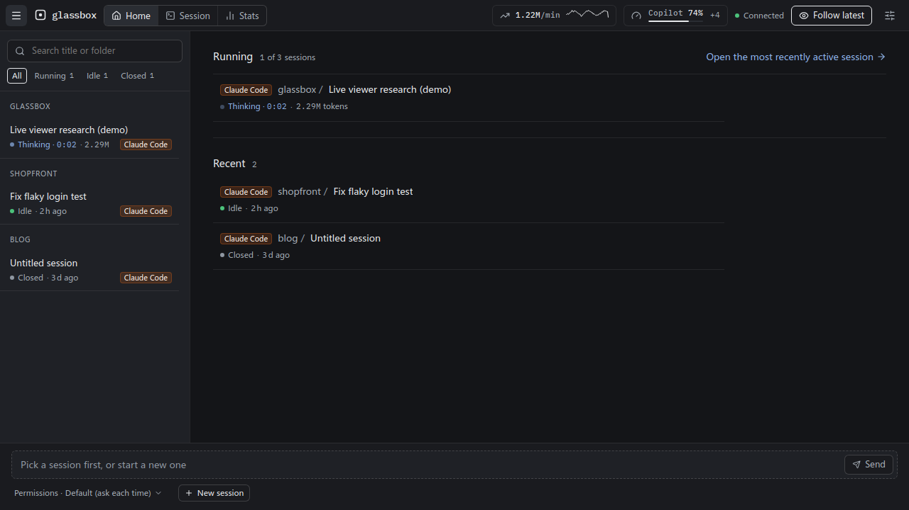
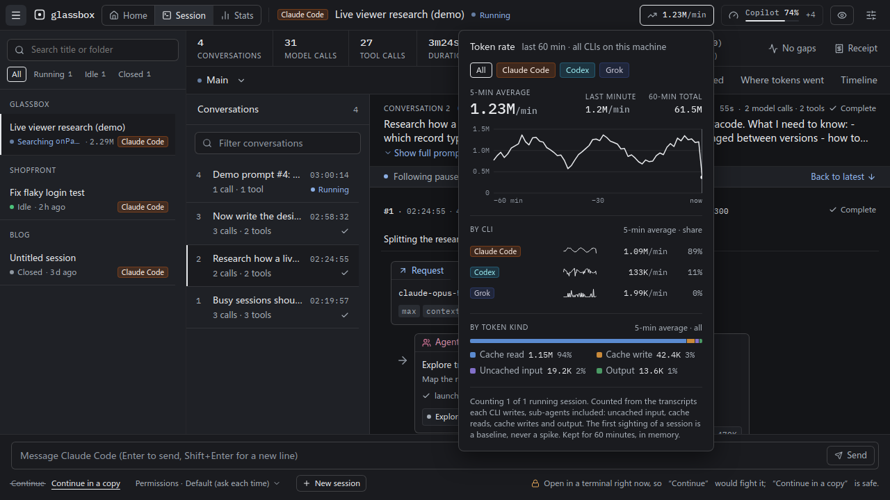
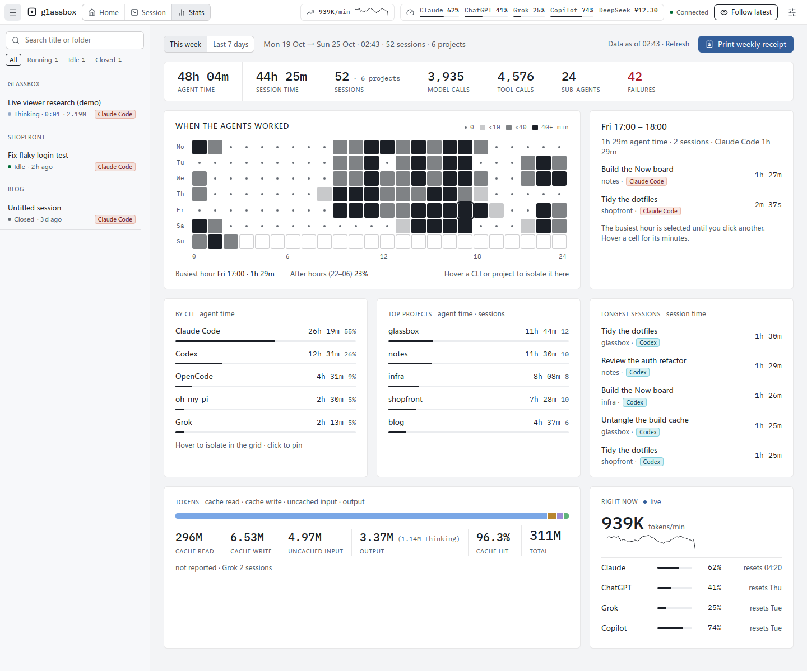
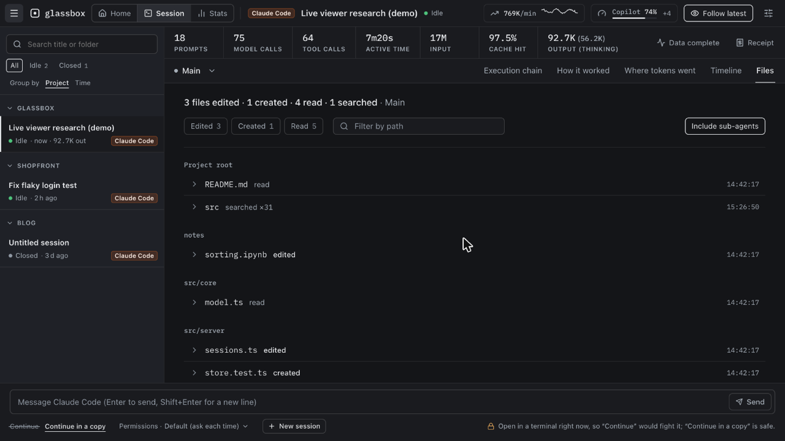
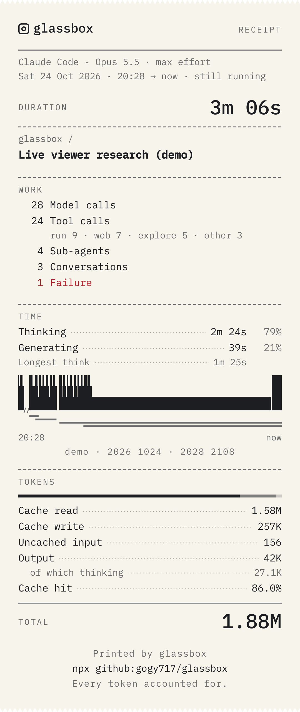
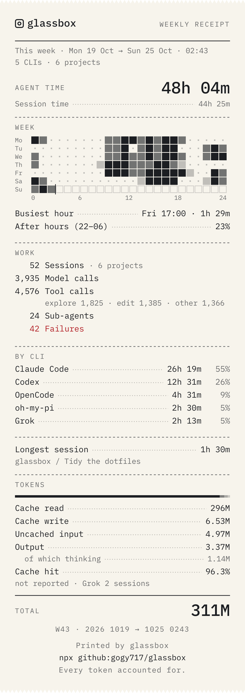

[中文](README.zh-CN.md)

# glassbox

**Turn Claude Code into a glass box.** While it works, see exactly what it is doing, which tools it calls, and where the tokens and the time go, including max effort and ultracode (Workflow multi-agent) runs. You can also message it straight from glassbox.

> A local, live viewer for Claude Code, Codex, Grok, oh-my-pi and OpenCode sessions: what each one is doing right now, the execution chain, a step-by-step breakdown of how the agent worked, where the tokens and the time went, plan quota and the token rate, and multi-agent workflow runs.


**Execution chain**: every model call of a turn, laid out as request → response → tools. Agent / Workflow cards show the progress of their sub-agents and phases; click through to see that agent's own chain.

|                                                          How it worked                                                           |                                                     Where tokens went                                                     |
| :------------------------------------------------------------------------------------------------------------------------------: | :-----------------------------------------------------------------------------------------------------------------------: |
|                                                                                           |                                                                               |
|            What each step thought, said and did, grouped into phases such as explore / edit / run; failures stand out            |    A one-line takeaway, the mix of cache reads, cache writes and output, a per-agent tree and the context growth curve    |
|                                                           **Timeline**                                                           |                                                    **Request details**                                                    |
|                                                                                             |                                                                                 |
| Whether the time went to thinking, generating, tools or idling; one lane per agent, so parallel workflow agents are easy to read |         The system prompt, messages and tools each request actually sent, as JSON trees you can copy and enlarge          |
|                                                       **Sending messages**                                                       |                                                     **Live overlay**                                                      |
|                                                                                      |                                                                                      |
|      Continue a session, or continue in a copy, from glassbox; replies stream in and permission prompts pop up in the page       |             No more black box while the model thinks: live thinking time, thinking tokens and streamed output             |
|                                                          **Home board**                                                          |                                                      **Token rate**                                                       |
|                                                                                               |                                                                                        |
|        Needs you, Working, Recent: which sessions wait for you and for what, which are working and on what, then the rest        |            Tokens a minute across this machine's CLIs, the last hour as a line; split by CLI and by token kind            |
|                                                            **Stats**                                                             |                                                         **Files**                                                         |
|                                                                                                   |                                                                                            |
|  When the agents worked this week, hour by hour; time by CLI and by project; the longest sessions, the tokens and the rate now   | Which files the session read, edited and created, by directory; each unfolds into its edits as diffs, linked to the calls |
|                                                           **Receipt**                                                            |                                                    **Weekly receipt**                                                     |
|                                     |                   |
| A session printed as a receipt: its work, time and tokens, with the timeline as its barcode; made in your browser, ready to post |     The week as a receipt, from Stats or a session's Receipt: agent time, the hours as a grid, time by CLI and tokens     |

## Run it

Requires Node.js ≥ 22.19 and Claude Code already in use on this machine.

```sh
npx --yes github:gogy717/glassbox
```

The first run downloads and builds (about a minute), then opens `http://127.0.0.1:7788` in your browser.

Pin a version (recommended, so the contents do not change with the branch):

```sh
npx --yes github:gogy717/glassbox#v0.6.1
```

Common options:

| Option                                    | Description                                                                                                                                                  |
| ----------------------------------------- | ------------------------------------------------------------------------------------------------------------------------------------------------------------ |
| `--port <n>`                              | Port, default `7788`                                                                                                                                         |
| `--no-open`                               | Don't open a browser                                                                                                                                         |
| `--claude-dir <path>`                     | Claude Code data dir, default `$CLAUDE_CONFIG_DIR` or `~/.claude`                                                                                            |
| `--grok-dir <path>` / `--no-grok`         | Grok data dir, default `$GROK_HOME` or `~/.grok` (Grok sessions show whenever it exists) / don't show them                                                   |
| `--codex-dir <path>` / `--no-codex`       | Codex data dir, default `$CODEX_HOME` or `~/.codex` (Codex sessions show whenever it exists) / don't show them                                               |
| `--omp-dir <path>` / `--no-omp`           | oh-my-pi dir, default `~/.omp` (sessions show whenever `agent/sessions` exists) / show neither its sessions nor its usage cache                              |
| `--opencode-dir <path>` / `--no-opencode` | OpenCode data dir, default `$XDG_DATA_HOME/opencode` or `~/.local/share/opencode` (OpenCode sessions show whenever it holds `opencode.db`) / don't show them |
| `--claude-bin <path>`                     | The `claude` used to send messages, default the one on `PATH`                                                                                                |
| `--use-api-key`                           | Let the `claude` started for messages use `ANTHROPIC_API_KEY` (default: the account you signed in with in the terminal)                                      |
| `--fetch-quota=<list>`                    | Ask only these providers for plan usage, e.g. `--fetch-quota=anthropic,deepseek` (default: all three every 5 minutes, see Data and privacy)                  |
| `--no-fetch-quota`                        | Ask no provider for plan usage: no network requests, no credentials read; the quota bar shows only what the agents cache                                     |
| `--demo`                                  | Run on built-in demo data: no local sessions are read, `claude` is never started and no provider is asked for plan usage                                     |
| `--help`                                  | List every option                                                                                                                                            |

To install it for good: `npm install -g github:gogy717/glassbox`, then run `glassbox`; uninstall with `npm uninstall -g glassbox`. To upgrade, run the command again with the new tag.

## What you can see

- **Three pages**: Home, Session and Stats, in the top bar; the glassbox wordmark goes Home too. Session takes you back to the session you last had open, or else to the most recently active one.
- **Keyboard**: ⌘K (Ctrl+K off a Mac), or Jump to… in the top bar, opens the palette: type a few letters of a session, a prompt of the session open, a page or a tab, or an action (New session, Print receipt, the language, the theme, the session list), then Enter. Without it, `/` searches the session list, `1`–`5` switch the session page's tabs, `j` / `k` move down / up the prompt list (the newest on top), `g h`, `g s` and `g t` go Home, to the session and to Stats, and `?` lists them all. While you type in a field, only ⌘K works.
- **Home board**: Needs you first: the sessions waiting for you, each saying what for ("Permission · Bash", "Question", "Your turn") and for how long; then Working, each saying what it is doing right now ("Reading tokens.css · 0:04", "Thinking · 1:12"); then Recent. The sidebar's rows say the same. A permission prompt of a session started from glassbox is answered on its row, with Allow or Deny (a question or a plan to approve opens the session, to be answered or read whole there); one a terminal holds says what it is about ("Permission · Bash · git push +1") and that the terminal is where to answer it. Under each session that waits or works, the first words of what its agent said last. The tab's title counts the sessions that need you ("(2) glassbox"), and a setting can send a desktop notification when one begins to wait.
- **Stats**: this week (from Monday) or the last 7 days, across every session glassbox lists: agent time, session time, sessions, model and tool calls, sub-agents and failures; a 7 × 24 grid of when the agents worked, with a card for the hour you pick (the busiest, to begin with); time by CLI and by project (hover one to see it alone in the grid, click to pin it); the longest sessions; the tokens; and right now, the token rate and plan usage. It reads the week each time you open it and every minute while it is in view; "Data as of" says when, and Refresh reads it again at once. Less than a day into the week, the Stats link opens on the last 7 days and says so once.
- **Execution chain**: organised by prompt (each message you sent), one row per model call: request → response → tools, failures in red; a call row reads `context 317K · new 4.9K · out 1.4K`, with the full token split on hover. The prompt list marks each day and folds runs of local commands. While the model thinks it shows "Thinking · m:ss", and running tools count up live.
- **How it worked**: each turn told step by step as "thought → said → did → outcome", grouped into phases such as explore / edit / run / delegate.
- **Where tokens went**: cache reads, cache writes, uncached input and output (including thinking); totals per agent and per Workflow phase; the context growth curve (with compaction points); the most expensive requests.
- **Timeline**: one lane per agent, split into waiting / thinking / generating / tools; where the time went and the 10 slowest steps.
- **Files**: which files the session read, searched, edited and created, by directory relative to the project, with counts and the last touch; a file unfolds into its calls in order, edits as two-colour diffs, each linked to the call in the execution chain. Filter by Edited / Created / Read or by path, with or without sub-agents. Recognises the file tools of Claude Code, Codex, OpenCode, oh-my-pi and Grok.
- **Multi-agent**: phases, agents, status and tokens of Agent sub-agents and Workflow (ultracode) runs; drill into any agent to see its own chain.
- **Request details**: with Claude Code ≥ 2.1.300, the system prompt, tools and messages each request actually sent to the model.
- **Plan usage per provider**: one meter per provider in the top bar, its window closest to the limit; click for every window, reset times, each window's pace (how much of it has gone and, if the limit comes first at this pace, when; the meter turns amber then), the plan, and where the numbers came from. Every 5 minutes glassbox asks the providers it can for fresh numbers (see Data and privacy), and shows whichever is newest: that answer or an agent's own cache. Stale data greys out per provider, says how old it is, and says why (such as an expired sign-in) and how it will refresh.
  - Anthropic: 5-hour / weekly / per-model quota, asked of Anthropic with Claude Code's sign-in, or from Claude Code's own cache (as ClaudeBar reads it).
  - OpenAI: the ChatGPT plan's limits from Codex's session logs, or from oh-my-pi's cache.
  - xAI (SuperGrok): the weekly credits, asked of xAI with Grok CLI's sign-in, or from oh-my-pi's usage cache.
  - GitHub Copilot: from oh-my-pi's usage cache.
  - DeepSeek: the account balance, asked of DeepSeek when `$DEEPSEEK_API_KEY` is set.
- **Token rate**: the top bar shows how many tokens a minute the CLIs on this machine spend (a 5-minute average, with the last hour as a line); click it to split the rate by CLI and by token kind. It counts the running sessions glassbox has open, and says how many of them that is ("Counting 2 of 3 running sessions"). The hour is kept in memory only, so it starts afresh each time glassbox starts.
- **Grok, Codex, oh-my-pi and OpenCode sessions**: when Grok Build, the Codex CLI, oh-my-pi or OpenCode is installed, their sessions appear in the sidebar too (view only), with sub-agents, tokens and time broken down the same way. An OpenCode session's child sessions show as its sub-agents.
- **Session list**: grouped by project (a worktree reads `repo/worktree`) or by time (Today, Yesterday, This week, Earlier); fold a group from its title; pin a session (the button beside its row, or P) to keep it at the top. Each group shows its running and idle sessions and the five newest closed ones, with "N more" for the rest. Search covers title and folder.
- **Summary bar**: prompts, model calls, tool calls, active time (and the days it spans), input, cache hit and output with its thinking share, as compact figures; the exact count is in each figure's tooltip.
- **API cost (estimate)**: what the same tokens would cost on the API, as "≈ $12.40" in the summary bar, beside each prompt, in the Tokens tab, on Stats and on both receipts (API EQUIV.). On a subscription you pay none of it: it is an estimate of the tokens billed per token at Anthropic's list prices. The price table is editable in Settings (API prices), one row per model, with Reset to defaults; a model without a price, such as Codex's or Grok's, is left out and said to have none.
- **Diagnostics**: at the right of the summary bar, "Data complete" or how many gaps there are; click it for what data this session lacks, and why.
- **Receipt**: press Receipt in the summary bar, then Copy image or Download PNG: the session as a receipt of its work, time and tokens, with its timeline as the barcode. Three sizes (Tall, Post 4:5, Story 9:16), on a paper or a night background, in English or Chinese; Copy as text gives the same receipt as plain text, for a PR or a chat. It is drawn in your browser from the data already on the page, without a single request, and it never prints a path: a path in the title keeps only its last part, and Hide names leaves out the title and the project as well.
- **Weekly receipt**: press Print weekly receipt on Stats, or set Scope to This week or Last 7 days in a session's Receipt: the week as a receipt of agent time, the hours as a grid, the busiest hour, the work, time by CLI, the longest session and the tokens. It has to read every session of the week, not just the open ones: the first open shows how far it has got, and later opens are instant. Sizes, backgrounds, languages, Copy as text and the privacy rules are the session receipt's: it is drawn in your browser, nothing leaves this machine, it never prints a path, and Hide names leaves out titles and project names.

## Sending messages from glassbox

The box at the bottom sends messages straight to Claude Code. Replies, thinking tokens and tool calls appear live, and permission prompts and Claude's questions pop up in the page for you to answer.
- **New session**: pick a working directory and a first message.
- **Continue**: carry on a session that has been closed.
- **Continue in a copy**: use this while the session is still open in a terminal. It continues in a new copy of the session, so it never fights the terminal over the same transcript.

glassbox starts the `claude` installed on your machine, with your own sign-in, so your `CLAUDE.md`, hooks and settings apply as usual. It only starts when you press Send, and the process ends when you close the session or quit glassbox.

## Accounts and terms

glassbox has no sign-in of its own and stores no credentials. To keep plan usage fresh it reads Claude Code's and Grok CLI's sign-ins and `$DEEPSEEK_API_KEY` (see Data and privacy; `--no-fetch-quota` turns this off). To send a message it starts the official `claude` installed on your machine (in its headless stream-json mode), with the account you are signed in to: the same one you use in a terminal. Make sure this use fits the Anthropic terms that apply to your account; if you are unsure, start glassbox with `--use-api-key` to use an API key instead.

glassbox is an independent project, not affiliated with or endorsed by Anthropic.

## Data and privacy

- Reads only:
  - `~/.claude` (session transcripts), and from `~/.claude.json` only the `cachedUsageUtilization` entry and, in `oauthAccount`, the account id (to tell whose that cache is) and the plan (organization type and rate-limit tier);
  - `~/.grok`;
  - the session records in `~/.codex` (`sessions/`, `archived_sessions/`, `session_index.jsonl`; never credential files such as `auth.json`);
  - oh-my-pi's sessions in `~/.omp/agent/sessions` with the full tool output omp saves beside them (`$PI_CODING_AGENT_DIR` moves `~/.omp/agent`), and its usage cache in `~/.omp/agent/agent.db`: only the usage reports in its `cache` table, never the credential tables. On Linux, `/proc/net/unix` tells whether oh-my-pi has a session open;
  - OpenCode's database `~/.local/share/opencode/opencode.db`: its sessions, messages and parts. The names of running processes (`/proc` on Linux, `ps` on macOS) tell whether OpenCode runs;
  - to ask for plan usage, the three credentials in the table below, unless you add `--no-fetch-quota`.
- Never changes a Claude Code, Grok, Codex, oh-my-pi or OpenCode file (when you message from glassbox, `claude` writes its own records, just as in a terminal), with one caveat for the SQLite databases below.
- oh-my-pi and OpenCode keep data in SQLite, which glassbox opens read-only for one short query at a time. While the owning app has pages waiting in its write-ahead log (`-wal`), and only when the `-wal` and `-shm` files have the database's own permissions, glassbox reads them as they are (`mode=ro`, `readonly_shm=1`: nothing is written, not even the shared-memory index); otherwise it opens the database file alone as immutable, and changes not yet checkpointed show up a little later. One rare race remains: if the app deletes its `-wal` between glassbox's check and its open, SQLite creates an empty `-wal` again (with the database's permissions, as the app itself would) and that one read fails. SQLite offers no way to rule this out.
- On Home and in the sidebar, what a running session is doing shows a shell command only as a summary: the program and its subcommand (`git push`), and "+N" for N more commands in a chain. Never the command line itself, whose flags and text can hold anything.
- Accepts connections from this machine only: it checks where a connection really comes from, and validates `Host` / `Origin` too. Every write needs a token generated at each start, so other web pages cannot read your sessions or send messages through it.
- Does not pass `ANTHROPIC_API_KEY` to the `claude` it starts (so you are not billed by the API by accident) unless you add `--use-api-key`.
- glassbox has no telemetry. Its only outbound requests ask for plan usage: every 5 minutes it reads one credential per provider and sends it to that provider's own host, and nowhere else:

  | Provider    | Request                                             | Credential                                                                                      |
  | ----------- | --------------------------------------------------- | ----------------------------------------------------------------------------------------------- |
  | `anthropic` | `api.anthropic.com/api/oauth/usage`                 | Claude Code's sign-in: the access token in `~/.claude/.credentials.json`, or the macOS Keychain |
  | `xai`       | `cli-chat-proxy.grok.com/v1/billing?format=credits` | Grok CLI's sign-in: the access token in `~/.grok/auth.json`                                     |
  | `deepseek`  | `api.deepseek.com/user/balance`                     | `$DEEPSEEK_API_KEY`                                                                             |

  Credentials are never logged, stored or refreshed. A provider whose credential is missing, or whose sign-in has expired, is skipped (and logged once) until you sign in or its own app renews it. Requests time out after 10 seconds and never follow redirects. The Anthropic and xAI endpoints are the ones Claude Code's `/usage` and Grok CLI use, not public APIs, so they may change.

  To turn this off, start glassbox with `--no-fetch-quota`: glassbox then reads none of these credentials and itself makes no network requests, and plan usage comes only from what the agents cache (it goes stale when they do not refresh it). `--fetch-quota=<list>` asks only the providers listed: `--fetch-quota=anthropic,deepseek` leaves out xAI, which `--no-grok` does not (it only hides Grok sessions). `--demo` never asks.

## Known limitations

- Claude Code writes a reply to disk only **once it is complete**, so while it thinks or generates glassbox can only show "in progress + time so far"; the content appears when the reply finishes.
- Claude Code keeps a short summary for only a few thinking blocks; most thinking is not in the local records. glassbox shows thinking time and thinking tokens.
- Request details and the "in progress" signal rely on records Claude Code added in 2.1.300; older sessions are marked "not recorded by this version".
- The transcript format is Claude Code's internal format and may change with upgrades; glassbox skips and counts anything it does not recognise instead of crashing.
- When you message from glassbox you see the reply text and the thinking-token count grow live, but Claude Code's streaming output does not include the thinking text itself.
- Grok and Codex sessions are view only. Grok records tokens per turn, so a turn's usage is attributed to its last call; Codex encrypts its thinking, so glassbox shows only Codex's own reasoning summaries and thinking tokens.
- oh-my-pi and OpenCode sessions are view only, and glassbox does not show the per-request cost they record. Request details are partial at best: oh-my-pi records them for sub-agents only, OpenCode only the model and its settings. oh-my-pi writes a reply only once it is complete, and its live state is known on Linux only. OpenCode's live state is a guess: an unfinished reply while OpenCode runs means busy, and anything else shows as closed (OpenCode records no waiting or idle state).
- glassbox counts OpenCode's reasoning tokens into output, as for every other agent, so its output reads higher than OpenCode's own. Only `opencode.db` in the data dir is read, not a database moved with `OPENCODE_DB` or another channel's `opencode-<channel>.db`; archived sessions show like the others.
- When glassbox does not ask Anthropic (`--no-fetch-quota`, or no usable Claude Code sign-in), Claude's quota comes from Claude Code's cache, which only `/usage` or ClaudeBar refreshes; when neither runs, it goes stale (the popover says so, and why). Signing in again or switching accounts clears that cache, so the quota disappears until the next refresh.
- oh-my-pi's usage cache only changes while oh-my-pi runs, so OpenAI and Copilot usage read from it, and xAI's when glassbox cannot ask xAI, goes stale when oh-my-pi is not in use.
- Codex records the ChatGPT plan's limits only when you sign in to Codex with ChatGPT, not with an API key.
- Grok CLI's sign-in lasts about 6 hours, and only Grok CLI renews it; when it has expired, glassbox skips xAI until Grok CLI runs again, and the popover says so.
- DeepSeek's balance shows one currency: the first with money on it.
- The token rate counts what it sees being written: right after glassbox starts or opens a session, the first few seconds and anything already in a transcript are not counted.
- The week starts at Monday 00:00 in the time zone of the machine glassbox runs on, while the Stats grid and the weekly receipt place each hour in your browser's time zone. Keep the two the same: when they differ (glassbox in a container set to UTC, say), the grid's days and hours come out shifted.
- glassbox holds the 8 most recently active running sessions in memory. On a machine running more than 8 at once, each new read of the week (the weekly receipt opened again, or Stats each minute) parses the others from disk again, so it takes longer.

## Local development

```sh
npm install
npm run dev        # demo data: server on 7788 + Vite on 5173
npm run dev:live   # real local sessions
npm run check      # typecheck + Biome + tests
npm run build && npm start
```

## Acknowledgements

- The UI ideas follow [dsh-plugin-agent-workflow](https://github.com/xuanyuanzhifeng/dsh-plugin-agent-workflow) (the workflow plugin of DeepSeek Harness).
- The way quota data is read follows [ClaudeBar](https://github.com/tddworks/ClaudeBar).

## License

[MIT](LICENSE)

The figures are set in IBM Plex Mono, bundled with glassbox: © IBM Corp., SIL Open Font License 1.1 ([license](web/public/fonts/LICENSE-IBM-Plex-Mono.txt)).
