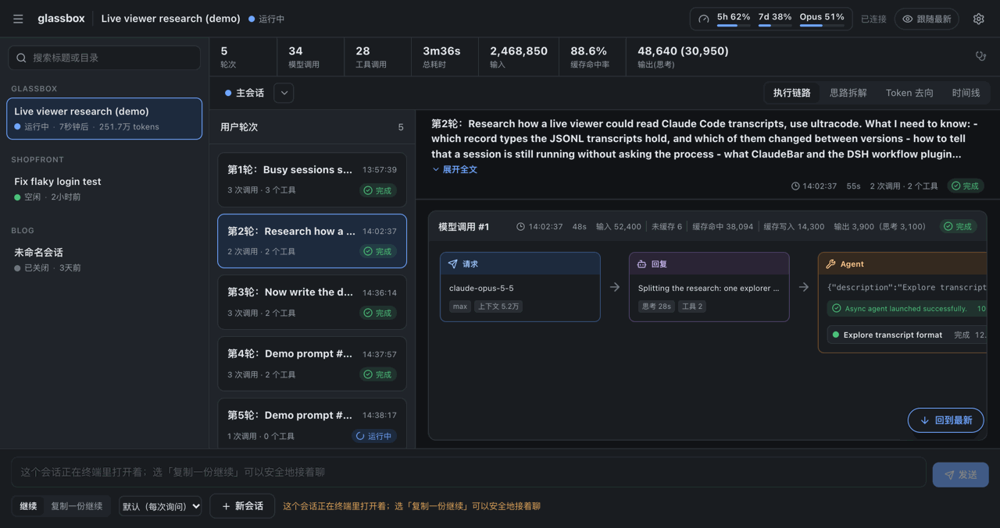
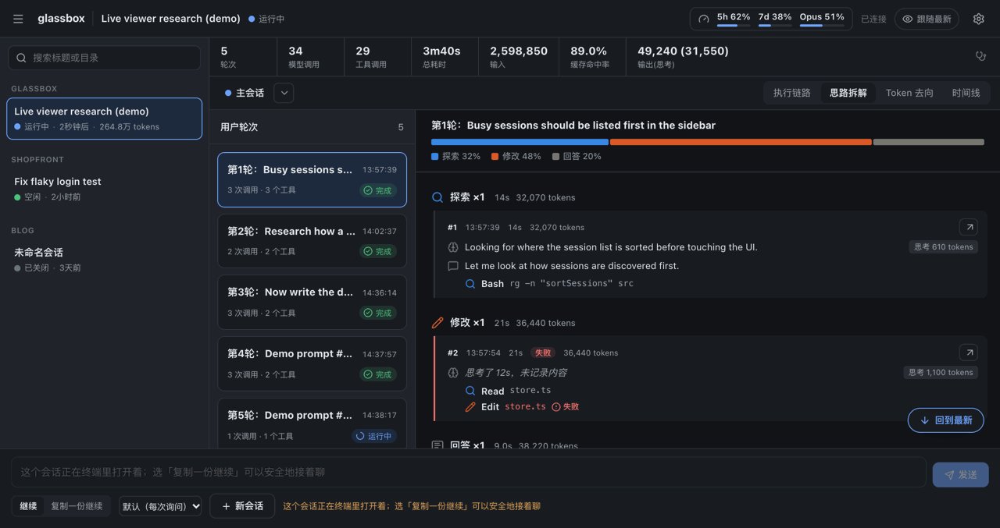
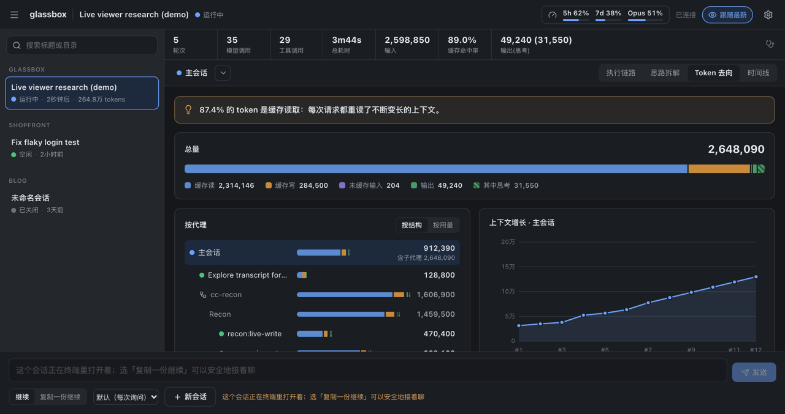
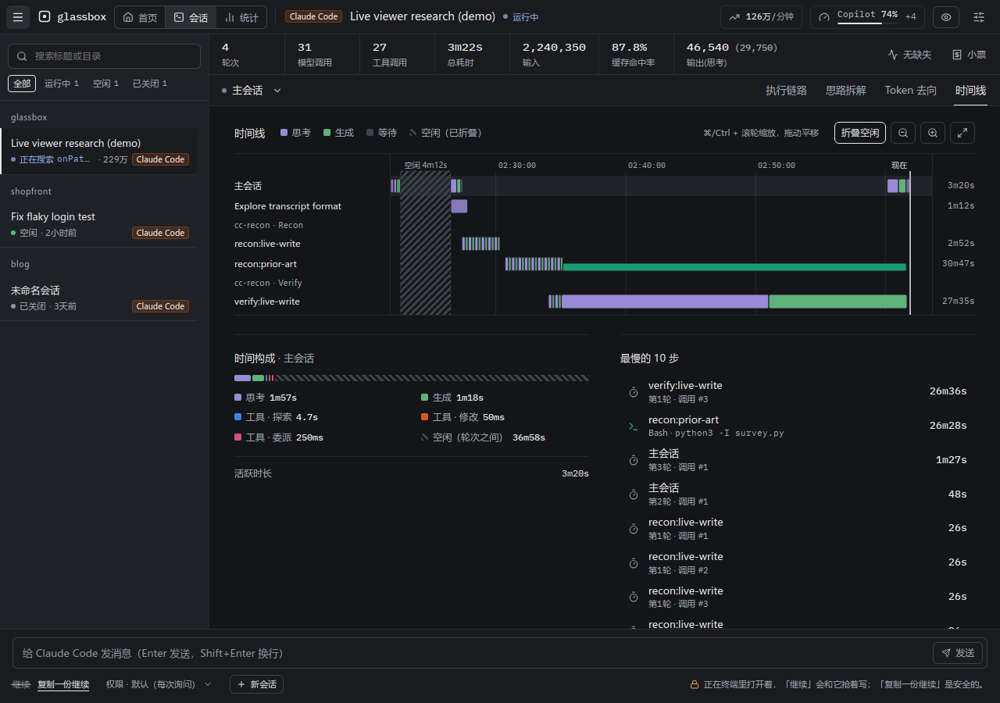
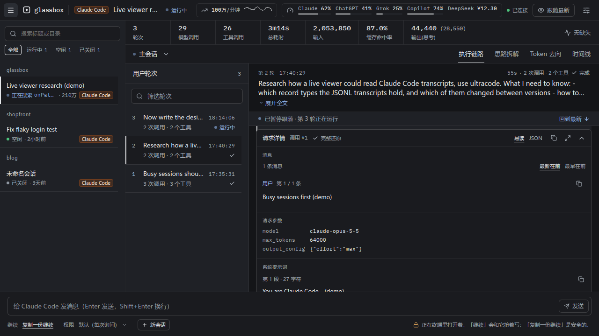
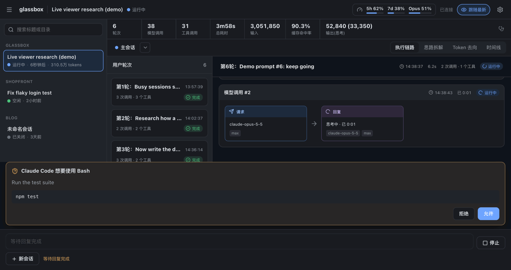
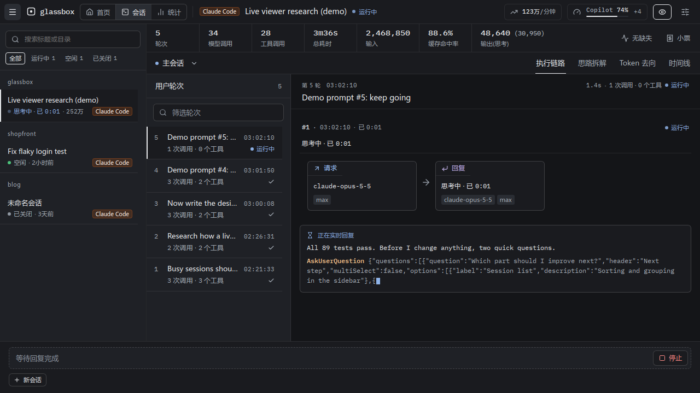
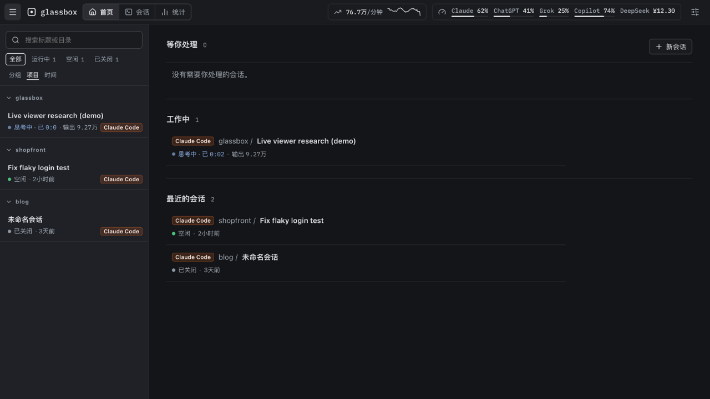
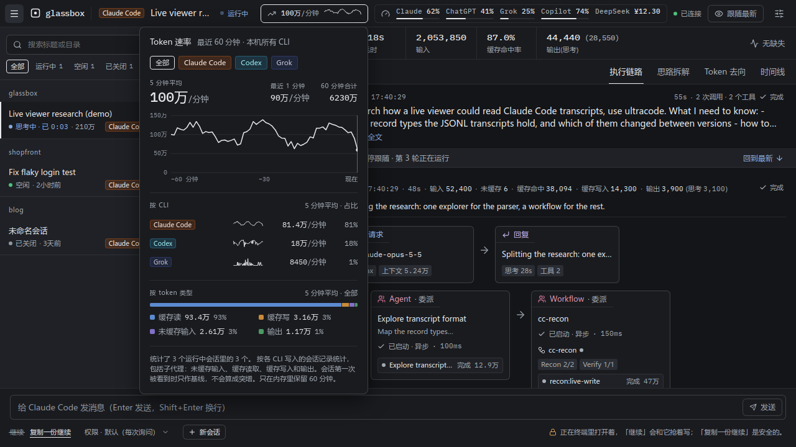

[English](README.md)

# glassbox

**把 Claude Code 变成玻璃盒子。** 在它干活的时候，实时看清它正在做什么、调用了哪些工具、token 和时间花在哪里——包括 max effort 和 ultracode（Workflow 多代理）运行；也可以直接在 glassbox 里给它发消息。

> 本地的实时查看器，用来看 Claude Code、Codex、Grok、oh-my-pi 和 OpenCode 的会话：每个会话此刻在做什么、执行链路、代理一步步怎么干活的拆解、token 和时间花在哪里、套餐额度和 token 速率，以及多代理 workflow 运行。



**执行链路**：按轮次展开每次模型调用——请求 → 回复 → 工具；Agent / Workflow 卡片直接显示子代理和各阶段的进度，点进去就能看那个代理自己的链路。

|                                     思路拆解                                     |                                     Token 去向                                      |
| :------------------------------------------------------------------------------: | :---------------------------------------------------------------------------------: |
|                                          |                                          |
| 每一步想了什么、说了什么、做了什么，按探索 / 修改 / 执行等阶段归组，失败一眼可见 |            一句话结论、缓存读写与输出的构成、按代理的树和上下文增长曲线             |
|                                    **时间线**                                    |                                    **请求详情**                                     |
|                                         |                                            |
| 时间花在思考、生成、工具还是空闲；每个代理一条泳道，并行的 workflow 代理一目了然 |        还原每次请求实际发出的 system、messages、tools，JSON 树可复制、可放大        |
|                                    **发消息**                                    |                                    **实时浮层**                                     |
|                                          |                                              |
|     在 glassbox 里继续或复制一份会话继续，回复实时流出，权限确认在界面里弹出     |           模型思考时也不再是黑盒：实时显示思考用时、思考 token 和流式输出           |
|                                   **首页看板**                                   |                                   **Token 速率**                                    |
|                                           |                                            |
|      正在运行的会话排在前面，每个都写着它此刻在做什么；后面是最近活跃的会话      | 本机各个 CLI 每分钟消耗的 token，最近一小时画成一条线；可以按 CLI 和 token 类型拆开 |

## 一键运行

需要 Node.js ≥ 22.19 和本机已经在用的 Claude Code。

```sh
npx --yes github:gogy717/glassbox
```

第一次运行会下载并构建（约 1 分钟），然后自动在浏览器打开 `http://127.0.0.1:7788`。

固定版本（推荐，避免内容随分支变化）：

```sh
npx --yes github:gogy717/glassbox#v0.3.0
```

常用参数：

| 参数                                      | 说明                                                                                                                                  |
| ----------------------------------------- | ------------------------------------------------------------------------------------------------------------------------------------- |
| `--port <n>`                              | 端口，默认 `7788`                                                                                                                     |
| `--no-open`                               | 不自动打开浏览器                                                                                                                      |
| `--claude-dir <path>`                     | Claude Code 数据目录，默认 `$CLAUDE_CONFIG_DIR` 或 `~/.claude`                                                                        |
| `--grok-dir <path>` / `--no-grok`         | Grok 数据目录，默认 `$GROK_HOME` 或 `~/.grok`（目录存在就显示 Grok 会话）/ 不显示                                                     |
| `--codex-dir <path>` / `--no-codex`       | Codex 数据目录，默认 `$CODEX_HOME` 或 `~/.codex`（目录存在就显示 Codex 会话）/ 不显示                                                 |
| `--omp-dir <path>` / `--no-omp`           | oh-my-pi 目录，默认 `~/.omp`（`agent/sessions` 存在就显示它的会话）/ 会话和用量缓存都不读                                             |
| `--opencode-dir <path>` / `--no-opencode` | OpenCode 数据目录，默认 `$XDG_DATA_HOME/opencode` 或 `~/.local/share/opencode`（目录里有 `opencode.db` 就显示 OpenCode 会话）/ 不显示 |
| `--claude-bin <path>`                     | 发消息时使用的 `claude`，默认取 `PATH` 里的                                                                                           |
| `--use-api-key`                           | 让发消息启动的 `claude` 使用 `ANTHROPIC_API_KEY`（默认用你在终端里登录的账号）                                                        |
| `--fetch-quota=<list>`                    | 只向列出的服务商查询用量，如 `--fetch-quota=anthropic,deepseek`（默认三家都查，每 5 分钟一次，见「数据与隐私」）                      |
| `--no-fetch-quota`                        | 不向任何服务商查询用量：不联网、不读凭据；顶栏只显示各智能体自己缓存的用量                                                            |
| `--demo`                                  | 用内置演示数据运行，不读取本机会话，不会启动 `claude`，也不向服务商查询用量                                                           |
| `--help`                                  | 查看全部参数                                                                                                                          |

想常驻安装：`npm install -g github:gogy717/glassbox`，之后直接运行 `glassbox`；卸载用 `npm uninstall -g glassbox`。升级：把命令里的版本号换成新的 tag 再运行一次。

## 能看到什么

- **首页看板**：首页先列出正在运行的会话，每个都写着它此刻在做什么（"正在读取 tokens.css · 0:04"、"思考中 · 1:12"、"等你确认"），再列出最近活跃的会话；侧栏的每一行也这样写。
- **执行链路**：按用户轮次组织，每次模型调用一行：请求 → 回复 → 工具，失败标红；模型正在思考时显示"思考中 · 已 m:ss"，工具运行中实时计时。
- **思路拆解**：每一轮按"想了什么 → 说了什么 → 做了什么 → 结果"逐步展开，并归成探索 / 修改 / 执行 / 委派等阶段。
- **Token 去向**：缓存读、缓存写、未缓存输入、输出（含思考）；按代理、Workflow 阶段汇总；上下文增长曲线（标出压缩点）；最贵的请求。
- **时间线**：每个代理一条泳道，区分等待 / 思考 / 生成 / 工具；时间构成与最慢的 10 步。
- **多代理**：Agent 子代理和 Workflow（ultracode）运行的阶段、代理、状态、token，可以钻进任意一个代理看它自己的链路。
- **请求详情**：Claude Code ≥ 2.1.300 时，还原每次请求实际发给模型的 system prompt、tools 和 messages。
- **各服务商的套餐用量**：顶栏每个服务商一个用量条，显示最接近上限的那个窗口；点开能看到每个窗口、重置时间、套餐和数据来源。glassbox 每 5 分钟向能查询的服务商要一次最新数字（见「数据与隐私」），和各智能体自己的缓存比较，显示较新的那份。数据旧了会按服务商分别变灰，标出是多久前的，并说明原因（比如登录已过期）和怎样才会刷新。
  - Anthropic：5 小时 / 每周 / 按模型的额度，用 Claude Code 的登录向 Anthropic 查询，或读取 Claude Code 自己的缓存（参考 ClaudeBar 的取法）。
  - OpenAI：ChatGPT 套餐的限额，来自 Codex 的会话日志或 oh-my-pi 的缓存。
  - xAI（SuperGrok）：每周额度，用 Grok CLI 的登录向 xAI 查询，或来自 oh-my-pi 的用量缓存。
  - GitHub Copilot：来自 oh-my-pi 的用量缓存。
  - DeepSeek：账户余额，设置了 `$DEEPSEEK_API_KEY` 时向 DeepSeek 查询。
- **Token 速率**：顶栏显示本机各个 CLI 每分钟消耗多少 token（5 分钟平均，最近一小时画成一条线）；点开可以按 CLI 和 token 类型拆开看。它统计 glassbox 打开着的运行中会话，并写明覆盖了几个（"统计了 3 个运行中会话里的 2 个"）。这一小时的数据只存在内存里，glassbox 每次启动都从头算起。
- **Grok、Codex、oh-my-pi 和 OpenCode 会话**：本机装了 Grok Build、Codex CLI、oh-my-pi 或 OpenCode 时，它们的会话也会出现在侧栏（只能查看），子代理、token 和时间同样可以拆开看。OpenCode 会话的子会话显示为它的子代理。
- **诊断**：汇总条右侧写着"无缺失"或缺了几项；点开能看到这个会话缺了哪些数据、为什么缺。

## 在 glassbox 里发消息

底部输入框直接给 Claude Code 发消息，回复、思考 token、工具调用实时出现，权限确认和 Claude 的提问在页面里弹出回答。
- **新会话**：选一个工作目录和第一条消息。
- **继续**：接着一个已经关闭的会话聊。
- **复制一份继续**：会话还开在终端里时用它——复制出一个新会话继续，不会和终端里的那个抢同一份记录。

glassbox 启动的是你本机安装的 `claude`，用你自己的登录，`CLAUDE.md`、hooks 和设置照常生效；只有你点"发送"时才会启动，关闭会话或退出 glassbox 时进程随之结束。

## 账号与条款

glassbox 自己没有登录功能，也不保存任何凭据。为了让套餐用量保持最新，它会读取 Claude Code 和 Grok CLI 的登录以及 `$DEEPSEEK_API_KEY`（见「数据与隐私」；加 `--no-fetch-quota` 可以关掉）。发消息时，它启动的是你本机安装的官方 `claude`（以无界面的 stream-json 模式运行），用的是你在终端里登录的同一个账号。请自行确认这种用法符合你的账号所适用的 Anthropic 条款；不确定的话，可以加 `--use-api-key` 改用 API key。

glassbox 是独立项目，与 Anthropic 没有关联，也未获其认可。

## 数据与隐私

- 只读：
  - `~/.claude`（会话转录）和 `~/.claude.json` 里的 `cachedUsageUtilization` 一项；
  - `~/.grok`；
  - `~/.codex` 里的会话记录（`sessions/`、`archived_sessions/`、`session_index.jsonl`，不碰 `auth.json` 之类的凭据文件）；
  - oh-my-pi 在 `~/.omp/agent/sessions` 里的会话以及 omp 存在旁边的完整工具输出（`$PI_CODING_AGENT_DIR` 可另指 `~/.omp/agent`），和 `~/.omp/agent/agent.db` 里的用量缓存：只读 `cache` 表里的用量报告，不碰凭据表。在 Linux 上，通过 `/proc/net/unix` 判断 oh-my-pi 是否开着某个会话；
  - OpenCode 的数据库 `~/.local/share/opencode/opencode.db`：其中的会话、消息和片段。通过正在运行的进程名（Linux 上读 `/proc`，macOS 上用 `ps`）判断 OpenCode 是否在运行；
  - 为了查询套餐用量，下表中的三项凭据；加了 `--no-fetch-quota` 时不读。
- 不修改任何 Claude Code / Grok / Codex / oh-my-pi / OpenCode 文件（用 glassbox 发消息时，记录由 `claude` 自己写入，和在终端里一样），SQLite 数据库有一处例外，见下一条。
- oh-my-pi 和 OpenCode 把数据存在 SQLite 里，glassbox 以只读方式打开，每次只做一个简短查询。只有当所属应用的预写日志（`-wal`）里还有未合并的页、并且 `-wal` 和 `-shm` 的权限与数据库文件一致时，glassbox 才直接读取它们（`mode=ro`、`readonly_shm=1`：什么都不写，共享内存索引也不写）；否则只把数据库文件当作不可变（immutable）打开，还没合并进去的改动会晚一点才显示。还剩一个罕见的竞态：如果应用恰好在 glassbox 检查之后、打开之前删掉了它的 `-wal`，SQLite 会重新建一个空的 `-wal`（权限与数据库一致，和应用自己建的一样），这一次读取失败。SQLite 没有办法完全避免这种情况。
- 首页和侧栏里写的"会话正在做什么"，对 shell 命令只显示摘要：程序名和子命令（`git push`），一串命令里后面还有 N 条就记作"+N"。从不显示命令行本身，因为参数和文本里什么都可能有。
- 只接受本机连接：看的是连接的真实来源地址，`Host` / `Origin` 也会校验；所有写操作需要每次启动随机生成的令牌，其他网页无法借道读取会话或发消息。
- 默认不把 `ANTHROPIC_API_KEY` 传给启动的 `claude`（避免意外按 API 计费），除非加 `--use-api-key`。
- glassbox 没有遥测。它唯一的外部网络请求是查询套餐用量：每 5 分钟对每个服务商读取一项凭据，只发给该服务商自己的主机：

  | 服务商      | 请求                                                | 凭据                                                                                  |
  | ----------- | --------------------------------------------------- | ------------------------------------------------------------------------------------- |
  | `anthropic` | `api.anthropic.com/api/oauth/usage`                 | Claude Code 的登录：`~/.claude/.credentials.json` 里的 access token，macOS 上是钥匙串 |
  | `xai`       | `cli-chat-proxy.grok.com/v1/billing?format=credits` | Grok CLI 的登录：`~/.grok/auth.json` 里的 access token                                |
  | `deepseek`  | `api.deepseek.com/user/balance`                     | `$DEEPSEEK_API_KEY`                                                                   |

  凭据不记日志、不保存、不刷新。缺凭据或登录已过期的服务商会被跳过（日志里只记一次），直到你登录或它自己的应用续期。请求 10 秒超时，不跟随重定向。Anthropic 和 xAI 的接口是 Claude Code 的 `/usage` 和 Grok CLI 用的那个，不是公开 API，以后可能会变。

  要关掉，用 `--no-fetch-quota` 启动：glassbox 这时不读这些凭据，自己也不发起任何网络请求，套餐用量只来自各智能体的缓存（它们不刷新时会变旧）。`--fetch-quota=<list>` 只查列出的服务商：`--fetch-quota=anthropic,deepseek` 不查 xAI，而 `--no-grok` 不会停掉 xAI 的查询（它只是不显示 Grok 会话）。`--demo` 从不查询。

## 已知限制

- Claude Code 在一次回复**完整生成后**才写盘，所以思考/生成过程中只能显示"进行中 + 已用时间"，内容要等回复完成才出现。
- Claude Code 只为少部分思考块保存了简短摘要，大部分思考内容不在本地记录里；glassbox 显示思考用时和思考 token。
- 请求详情、"进行中"信号依赖 Claude Code 2.1.300 起新增的记录；更早的会话会标注"此版本未记录"。
- 转录格式是 Claude Code 的内部格式，升级后可能变化；glassbox 遇到不认识的内容会跳过并计数，不会崩溃。
- 用 glassbox 发消息时能实时看到回复文字和思考 token 的增长，但 Claude Code 的流式输出里没有思考的文字本身。
- Grok 和 Codex 会话只能查看。Grok 只按轮次记录 token，所以一轮的用量记在这一轮的最后一次调用上；Codex 的思考内容是加密的，只能显示它自带的推理摘要和思考 token。
- oh-my-pi 和 OpenCode 会话只能查看，glassbox 不显示它们记录的每次请求的费用。请求详情最多只有一部分：oh-my-pi 只为子代理记录，OpenCode 只记录模型和它的设置。oh-my-pi 在一次回复完成后才写盘，它的运行状态只在 Linux 上能看到。OpenCode 的运行状态是推测的：OpenCode 在运行且有未完成的回复时算作忙碌，其余都显示为已关闭（OpenCode 不记录等待或空闲状态）。
- glassbox 把 OpenCode 的推理 token 计入输出（和其他代理一样），所以输出数会比 OpenCode 自己显示的大。只读数据目录里的 `opencode.db`，不跟随 `OPENCODE_DB` 指到别处的数据库，也不读其他渠道的 `opencode-<channel>.db`；已归档的会话和其他会话一样显示。
- glassbox 不向 Anthropic 查询时（用了 `--no-fetch-quota`，或没有可用的 Claude Code 登录），Claude 的额度只来自 Claude Code 的缓存，而这份缓存只有 `/usage` 或 ClaudeBar 会刷新；两者都没有运行时，数据会变旧（弹层会标出并说明原因）。重新登录或切换账号会清空这份缓存，额度会消失，直到下一次刷新。
- oh-my-pi 的用量缓存只在 oh-my-pi 运行时更新，所以从它读到的 OpenAI、Copilot 用量，以及 glassbox 查不到 xAI 时读到的 xAI 用量，在不用 oh-my-pi 时会变旧。
- 只有用 ChatGPT 登录 Codex 时，Codex 才会记录 ChatGPT 套餐的限额；用 API key 登录时没有。
- Grok CLI 的登录大约 6 小时有效，只有 Grok CLI 自己会续期；过期后 glassbox 会跳过 xAI，直到 Grok CLI 再次运行，弹层里也会这样说明。
- DeepSeek 余额只显示一种币种：第一个有余额的币种。
- Token 速率只统计它看着写进记录的内容：glassbox 刚启动或刚打开一个会话时，最初几秒和记录里已经有的内容都不计入。

## 本地开发

```sh
npm install
npm run dev        # 演示数据：服务端 7788 + Vite 5173
npm run dev:live   # 本机真实会话
npm run check      # 类型检查 + Biome + 测试
npm run build && npm start
```

## 致谢

- 界面思路参考 [dsh-plugin-agent-workflow](https://github.com/xuanyuanzhifeng/dsh-plugin-agent-workflow)（DeepSeek Harness 的工作流插件）。
- 额度数据的取法参考 [ClaudeBar](https://github.com/tddworks/ClaudeBar)。

## 许可证

[MIT](LICENSE)

数字使用随 glassbox 附带的 IBM Plex Mono 字体：© IBM Corp.，SIL Open Font License 1.1（[许可证](web/public/fonts/LICENSE-IBM-Plex-Mono.txt)）。
